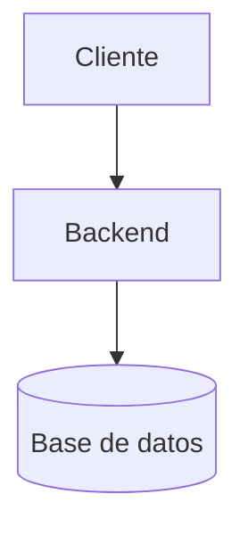

# Arquitectura — __PROJECT__

## Contexto y contenedores

## Mapa de módulos
- <módulo> — base | feature — <dependencias>

## Reglas de capas y datos
- interface → application → domain; infrastructure implementa puertos.
- Cada módulo es dueño de sus tablas; referencia por id.

## Esqueleto andante
<rebanada vertical mínima>

## Evolución prevista
| Señal medible | Umbral | Siguiente paso | Qué lo habilita ya |
|---|---|---|---|

## Para investigar
- <términos exactos>
